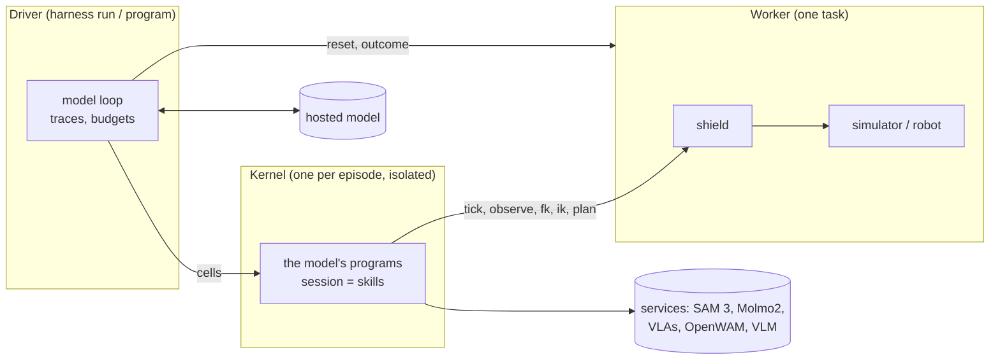

# The episode runtime

Three layers and a shield: a model writes programs (high level), programs call bounded
skills (low level), guards and controllers run every control tick (reactive layer), and
a fixed shield checks every command before it reaches the robot.

## Processes

| Process | Started by | What it does |
|---|---|---|
| Worker | `harness run` (or `harness serve`) | one task of a bench: `reset`, `tick` (one control step through the shield), `state`, `observe`, `fk` / `ik` / `plan`, the outcome |
| Services | `harness up`, or the broker on first use | the models skills call ([Services and deploys](services.md)) |
| Driver | `harness run` / `harness program` | the model loop, traces, budgets |
| Kernel | the driver, per episode | runs the model's programs in a namespace of skills |

## The driver: when the model is called

`src/harness_policy/runtime/driver.py`. Each model call is a *decision point*, counted
by reason in `summary.json` (`decisions`):

| Reason | When |
|---|---|
| `start` | the first call: instruction, task description (if the configuration uses them), robot state, camera images |
| `escalation` | a program stopped on an event nothing in it handled |
| `error` | a program raised an exception |
| `program_end` | a program ended without calling `finish()` |
| `verify` | the model asked the success verifier (`<verify>`) |
| `format` | the last reply had no valid block |
| `action` | direct mode (R0/R1): after every action |

A reply holds exactly one block after an optional thought: `<python>` (a program),
`<verify>` (a claim for the verifier) or `<finish>` (done); in direct mode
`<action>{JSON}</action>` or `<finish>`. A reply without a valid block costs a call and
is answered with *"Format error ... Nothing ran"*; once a valid reply arrives, the bad
exchanges leave the history.

After a program cell, the model gets the cell's status and output, the event that
stopped it, the last executions, the enabled skills' turn reports (the tools by object
id: the scene measured again, labelled for the next program, with each holding arm's
grip), the robot state and the env steps used, the images the program attached with
`show()` plus fresh camera views (outlined where a turn report outlines them), and the
number of calls left. With learned policies, `start(strategy, kind)` is the first
motion: until it is called, every execution that moves the arms ends with `SKILL_ERROR`
(`runtime.strategy_first`), and `summary.json` records the choice as `strategy`
([the division of labor](design.md#division-of-labor-the-program-and-the-learned-policy)).

**After the policy's run.** Once the task handed over with `start("A" or "C")` has run,
the model has `post_policy_calls` more calls (4 in the agent; each turn says how many are
left). When they are used up the driver runs the kernel's `__policy_to_end__()` hook
(event `policy_to_end`): the policy runs on from where it is to the end of the episode,
with no stall stop. If the episode is still running after that, the driver finishes it
(`finish` with `source: "driver"`) and runs the wrap-up.

**Budgets and statuses.** Per episode: `max_model_calls` (the agent's budget: 30),
`max_wall_seconds` (checked before each model call; a running cell is bounded by
`cell_timeout_seconds`), and optionally `max_cost_usd`. An episode ends as
`finished` (`<finish>` or `finish()`), `episode_ended` (the bench ended it: success or
step limit), `budget_exhausted`, `wall_time_exhausted`, `cost_exhausted`,
`interrupted`, or `error`.

**History.** Text history is kept; images only for the last `keep_images` turns (older
ones become *"[earlier image omitted]"*); `max_history_turns` keeps the first message
plus the last N exchanges, for small-context models.

**Verifier.** With `runtime.verifier` on (the default), `<verify>` and `verify()` in
programs ask the verifier role (the main model unless overridden) whether the claim
holds, with a fresh observation: YES/NO and one sentence.

**Wrap-up and outcome.** After `finish`, the driver runs the wrap-up when the
embodiment asks for it (RoboDojo does): every gripper that holds nothing opens, then
both arms return to their start pose. RoboDojo scores 23 of its 42 tasks only with
every gripper at least 0.8 open, and most count success only with the arms home; a
gripper that holds something stays closed, since the lifting tasks score the object
still in the air. The outcome is read with a token the driver claims at reset; programs
and the model never see it.

## The kernel: where programs run

`src/harness_policy/runtime/kernel.py`. One Python process per episode; variables
persist from one program (cell) to the next. A cell ends as `ok`, `escalated` (with the
event's trace), `episode_ended`, `finished`, or `error` (traceback limited to the
program's own frames). Output is clipped to 8000 characters. After each cell the kernel
restores any API name a program rebound (`def pick(...)`) and says so in the output.

Programs run isolated: they see only the Python installation and the harness source
(read-only) and a fresh workspace, reach only the services in their options, and cannot
start processes. See [Isolate programs](../how-to/isolation.md).

## The session: skills as bounded executions

The session class is the **episode core** (`src/harness_policy/runtime/episode.py`)
specialized for one **embodiment kind**, plus the mixin of every skill for that kind
(`skills/<name>/`); the enabled skills decide which names a program sees. The episode
core holds what does not depend on the embodiment: the worker connection, the model
clients and learned policies, handlers, the reactive layer, and bounded executions. An
embodiment kind's session says what a step's command is and how it reaches the worker,
the command that leaves everything as it is, what guards observe, when a command leaves
an execution's scope, and which guard actions it takes itself. The robot's is
`RobotSession` (`runtime/session.py`): a command is the joint vector of both arms, the
scope a region one arm's link6 must stay in, and a guard may also open the grippers. The
bench decides the kind (RoboDojo and RoboTwin drive robots), the worker reports it in
its profile (`kind`, default robot), and a run whose worker drives another kind stops
with an error. Every motion is a **bounded execution**: it runs tick by tick until it
completes, a predicate or guard fires, it leaves its scope, or `max_seconds` passes, and
ends with an **event** and an **execution trace**.

| Event | Meaning |
|---|---|
| `COMPLETED`, `PREDICATE_SATISFIED` | nominal: the execution did what it was asked (`until` held) |
| `TIMEOUT` | `max_seconds` passed |
| `BLOCKED` | the arm stopped short of its target (more than 1 cm or 0.05 rad after settling) |
| `GUARD_TRIGGERED` (or a guard's own event name) | a guard of the reactive layer fired |
| `REGION_EXIT` | the execution left its scope (a robot arm left its region) |
| `SHIELD_REJECTED` | the shield refused a command (with its reasons) |
| `REACTIVE_FAULT` | a guard or controller failed or ran over its time budget |
| `SKILL_ERROR` | a skill could not do what was asked |
| `EPISODE_ENDED` | the bench ended the episode |

A non-nominal event goes to the handler the program registered for it with
`on(event, handler)`. Without a handler, or if the handler returns `False`, the event
**escalates**: the cell stops and the model is called with the trace (`escalation`).
`finish(summary)` ends the episode from inside a program.

## The reactive layer

Guards and controllers run every control tick (25 Hz on RoboDojo) without asking the
model:

- `when(predicate, action)` — a guard: when the predicate holds, `stop`, `hold`,
  `open_gripper`, or raise an event of that name.
- `watch(signal, low, high)` — a guard on a numeric signal leaving a range.
- `clear_guards(names=None)`.
- `run_controller(fn, until, max_seconds, region, hz, cameras, camera_hz)` — `fn` maps
  the observation to joint, end-effector (`left_eef` / `right_eef`, solved by IK) or
  gripper targets, at `hz`; with `cameras`, fresh images and calibration for visual
  servoing.

Reactive code gets a time budget per call (`runtime.reactive_budget_ms`; 20 ms in the
agent) and may not do I/O, sleep or call models; a violation is a
`REACTIVE_FAULT`.

## The shield

`src/harness_policy/runtime/shield.py` runs in the worker, outside the programs' reach,
and checks every command of every tick. It rejects commands that are bugs and changes
nothing else: it never clamps, shortens or slows a command.

| Check | Rejects |
|---|---|
| shape, finite | a malformed command |
| joint limits | a target further past a limit than the joint already is (plus a 1e-3 rad tolerance) |
| joint jump | an arm joint jumping more than `max_joint_jump_rad` from both the last accepted command and the measured state |
| workspace | an end effector further outside the workspace box than it already is |
| Cartesian jump | an end effector jumping more than `max_cartesian_jump_m` from both the last command and the measured pose |

A rejected command is not executed; the execution ends with `SHIELD_REJECTED` and the
reasons, so the program learns that its command was wrong. The RoboDojo limits are in
the embodiment (`embodiments/arx_x5`): 0.3 rad, 0.25 m, and the workspace box.
