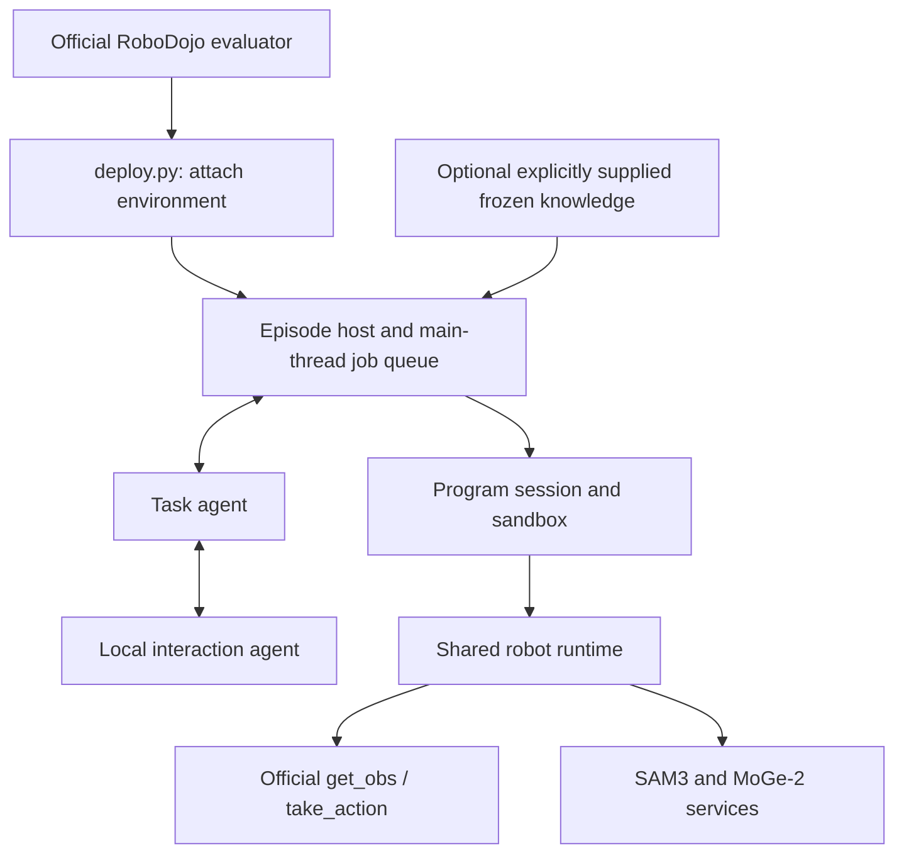

# Architecture

KnowinAgent has a task agent, a local interaction agent and a shared robot runtime. The agent writes short programs, reads current images and receipts, and chooses the next step. Robot control stays in the host process; the Codex processes connect through the `knowin_agent` MCP server.



## Integration layout

`knowin_agent/` contains the runtime and its package resources; `knowledge/` contains an empty knowledge index. The official entry points, including `train.sh` and `eval.sh`, live at the [policy root](../README.md). `_paths.py` locates the bundled runtime and resources beside the adapter from its resolved file path.

## Agent and runtime

`assembly.py` resolves configuration and assembles the backend, runtime, workspace, program session and tools. `bridge/host.py` owns episode state and starts Codex sessions. Socket threads enqueue work; simulator operations execute on the main thread. Task and local agents reason in sequence, while the runtime can advance both arm motion lanes concurrently.

The task agent plans and delegates bounded local interactions. The local agent shares the runtime and current scene context, with its interaction contract enforced by the host. Programs execute through `program/session.py` and the restricted sandbox; checkpoints, motion budgets and stop conditions return receipts. A returned motion status does not establish grasp retention or task success.

Core functions such as `move_to`, `pick`, `place` and `checkpoint` are preloaded. Task helpers use `skills/<name>.py`; shared helpers use `skills/shared/<name>.py`. The optional built-in include namespace is `knowin_agent:<module>`. The host rejects path escapes, symlinks and unsupported includes. The detailed Agent-facing contracts remain in `program/docs/` and `agents/prompts/`.

## Observations and actions

The official evaluation adapter wraps the evaluator's existing environment. It uses `get_obs`, `take_action`, the native action counter and the episode-end flag. It neither reads live task scores, reward-manager state, simulator object poses or success flags, nor resets or closes the evaluator's environment. If the agent stops early, `hold_until_end` completes the remaining official episode with hold actions.

The evaluation configuration uses RGB observations and rig-constant calibration. Wrist camera pose is computed from the observed flange pose and the fixed flange-to-camera transform. SAM3 supplies masks and MoGe-2 supplies point maps; perception is evidence for planning, not a native success measurement.

XPolicyLab owns transport image decoding through its official `decode_obs_images` utility. The debug adapter exercises raw RGB and encoded observations through the policy server and client. Normal simulator observations arrive directly from the evaluator. The `Image.open` call in `perception/services.py::decode_mask_png` decodes the segmentation service's PNG mask; it is not a trajectory RGB decoder or a colour-channel correction.

## Knowledge

The task brief combines scoring notes, a supplied recipe and the official task-source reference according to the existing switches. Recipes and references are checksum-pinned. The shipped profile includes task-source knowledge; this is supplied knowledge, distinct from the live observations available to the policy.

Each episode stages a workspace:

```text
workspace/
  instruction.md
  skills/          task helpers: practice writable, test read-only
    shared/        optional supplied shared helpers: read-only
  lessons/         task experience: practice writable, test read-only
  scratch/         temporary working notes
```

This integration omits learned task directories and the learned shared library, including their manifests. Default configuration sets `evolution.shared_library` to `off` and supplies no frozen task path. Built-in framework tools remain preloaded. Optional explicit frozen knowledge or an external training registry can stage user-generated assets.

Training freezes its actual workspace, including the shared-library copy used for that run. Review preserves that copy while merging task knowledge. The package library cannot be overwritten through registry publication. Shared-library curation can use a separately configured external registry; its generated versions belong to training outputs.

## Backends and records

`OfficialRoboDojoBackend` attaches to an evaluation already owned by RoboDojo. `RoboDojoBackend` is the independent practice backend: one process owns one simulator instance and one layout. Its seed encodes `bank * 1_000_000 + ordinal`; this differs from the official evaluation launcher's bank seed. Practice may reset the same scene through native close/reset, and records reset events and cumulative ticks separately from the current attempt's action allowance.

Run directories contain configuration, tool-call receipts, manifests and optional video. Native actions, accepted program executions, model calls and wall time are separate counters. `experiments/` supplies switch resolution, scene partitions, manifest collection and result tables; its labels do not themselves certify official eligibility. Changes to task routing, supplied knowledge or model settings require disclosure when submitting a fixed system for evaluation.

## Debug and validation

`EVAL_ENV_TYPE=debug` activates an adapter-only dry run using XPolicyLab's `TestEnv`, whose interface has `episode_step_limit`, `is_episode_end`, `get_obs` and `take_action`. It does not have the simulator backend's native fields. The adapter validates any explicitly supplied frozen knowledge, builds the host components without model/perception requests, and runs legal hold actions through the official client/server path. Simulation rejects the dry-run flag.

CPU tests cover control contracts, workspace permissions, knowledge hashes, include rules, review orchestration and shared helpers. Debug covers adapter transport. Real practice, simulator task success and official benchmark scores require their own runs and evidence.
